<picture>
  <source media="(max-width: 700px)" srcset="./assets/terminal-mobile.svg">
  
</picture>

<p>
  <code>~/links</code>&nbsp;&nbsp;
  <a href="https://github.com/mvrhaa"><code>github</code></a>
</p>

<details>
<summary><code>$ ./eye --stop</code></summary>

```console
eye: refusing to stop: someone is still reading this terminal
```

</details>
