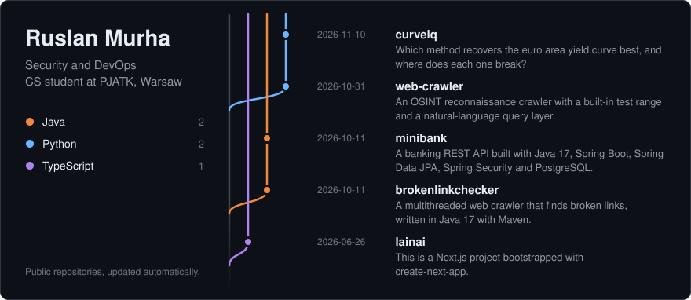

<picture>
  <source media="(max-width: 700px)" srcset="./assets/graph-mobile.svg">
  
</picture>

I'm Ruslan, a second-year Computer Science student at PJATK in Warsaw.

Most of what I build sits between security and data: an OSINT crawler that maps a site only inside the scope it is allowed to touch, a log watcher that flags brute-force SSH logins, and a banking REST API on Spring Boot with Spring Security. I also like quant problems, and I test every model against a plain baseline, for example how well three methods rebuild the euro area yield curve. With my team I won the Quantum Optimization track at IBM Qiskit Fall Fest 2026.

The graph above is built from my public repositories and redraws itself when I publish a new one.

  <code>~/repos</code>&nbsp;&nbsp;
  <a href="https://github.com/mvrhaa/curvelq"><code>curvelq</code></a>&nbsp;&nbsp;
  <a href="https://github.com/mvrhaa/web-crawler"><code>web-crawler</code></a>&nbsp;&nbsp;
  <a href="https://github.com/mvrhaa/minibank"><code>minibank</code></a>&nbsp;&nbsp;
  <a href="https://github.com/mvrhaa/brokenlinkchecker"><code>brokenlinkchecker</code></a>&nbsp;&nbsp;
  <a href="https://github.com/mvrhaa/lainai"><code>lainai</code></a>

  <code>~/links</code>&nbsp;&nbsp;
  <a href="https://www.linkedin.com/in/ruslan-murha-08309638a"><code>linkedin</code></a>&nbsp;&nbsp;
  <a href="https://t.me/mvrhaa"><code>telegram @mvrhaa</code></a>

